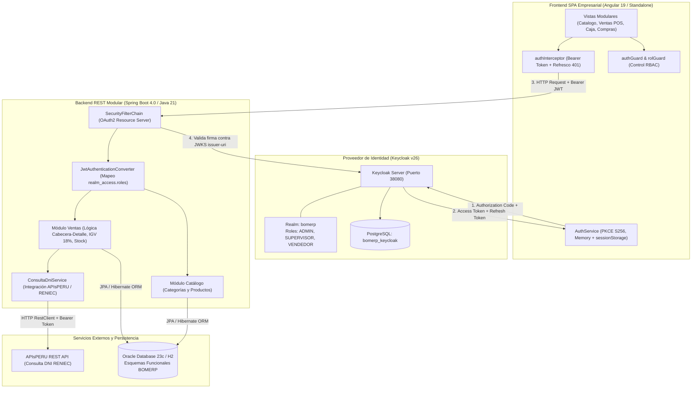

# INFORME TÉCNICO: PRODUCTO DE UNIDAD 2 (LP2)
## Frontend SPA Empresarial Modular y Seguro Integrado a Backend REST y Keycloak
### Proyecto Integrador: ERP Agro Peruvian Foods S.A.C. | Segundo Corte Integrado (ADS - BD2 - LP2)

| Campo | Detalle |
| :--- | :--- |
| **Equipo:** | **Los Hijos del Backend** (Sección G2G3) |
| **Proyecto:** | ERP Agro Peruvian Foods S.A.C. |
| **Repositorio GitHub:** | `https://github.com/leonardogodxd17-spec/AgroPeruvianFoods.git` |
| **Corte Evaluado:** | Sesión 12 - Evaluación de la Unidad II (S07 - S11) |
| **Proveedor de Identidad:** | Keycloak v26 (Realm `bomerp`, OAuth2 / OpenID Connect + PKCE) |
| **Persistencia / BD:** | Oracle Database 23c Free / H2 in-memory |

### Integrantes y Asignación de Módulos Transaccionales:
| Integrante | Módulo Asignado | Tipo de Módulo | Entidad Cabecera-Detalle |
| :--- | :--- | :---: | :--- |
| **Morales Auquipata Zaggy Leonardo** | Ventas y Tickets POS | Transaccional | `Venta` / `DetalleVenta` |
| **Ccalla Colquehuanca Brandon Andree** | Gestión Financiera de Caja | Transaccional | `SesionCaja` / `MovimientoCaja` |
| **Armuto Uñapilco Isai** | Producción y Envasado BOM | Transaccional | `OrdenProduccion` / `DetalleOrden` |
| **Huaylla Nestor Elisban** | Compras y Abastecimiento | Transaccional | `OrdenCompra` / `DetalleCompra` |

---

## Descripción del Producto de Unidad 2
Frontend SPA empresarial modular y seguro desarrollado en **Angular 19 (Standalone Components)**, conectado al único backend **Spring Boot 4.0 / Java 21** de BomERP mediante APIs REST con serialización JSON, consumo de tokens criptográficos emitidos por **Keycloak** (OpenID Connect / OAuth2), navegación estructurada por módulos funcionales, operaciones CRUD independientes y dependientes con validación de relaciones, formularios transaccionales cabecera-detalle con cálculos en vivo, integración a la API de **APIsPERU (RENIEC)** para consulta de DNI en tiempo real, previsualización e impresión de tickets térmicos POS de 80mm, consultas empresariales, reportes agregados y control estricto de acceso basado en roles (RBAC).

---

## 1. Organización Funcional de la SPA U2

Siguiendo estrictamente las directrices arquitectónicas de la Unidad 2, el frontend se estructura en una única SPA modular bajo el estándar `core / shared / features`. No existe carpeta `features/seguridad/` ya que la identidad no es una función de negocio, sino un servicio transversal desacoplado en `core/auth`:

```text
bomerp-frontend/src/app/
├── core/
│   ├── auth/                     # AuthService, PKCE (S256), decode JWT (Keycloak)
│   │   ├── auth-callback.ts      # Receptor del código de autorización OAuth2
│   │   ├── auth-service.ts       # Gestión de sesión, login PKCE, refresh y logout
│   │   ├── jwt.ts                # Parser seguro del payload JWT
│   │   └── pkce.ts               # Generador criptográfico de verifier, state y challenge S256
│   ├── guards/                   # authGuard (bloqueo sin sesión), rolGuard (RBAC)
│   ├── interceptors/             # authInterceptor (inyecta Bearer, refresco único en 401)
│   │                             # traceIdInterceptor (correlación X-Trace-ID)
│   ├── layout/                   # Shell principal, Header, Sidebar dinámico por rol
│   └── sin-permiso/              # Vista informativa de acceso denegado (HTTP 403)
├── shared/                       # Componentes visuales y directivas transversales
└── features/
    ├── catalogo/                 # S07/S08: CRUD Categorías (independiente) y Productos (dependiente)
    ├── ventas/                   # S09/S11: Ventas cabecera-detalle, FormArray, DNI, Ticket térmico
    ├── caja/                     # S09: Sesión y Arqueo de turnos de caja chica
    ├── compras/                  # S08/S09: Proveedores y órdenes de abastecimiento
    └── produccion/               # S09: Órdenes de fabricación por lotes (BOM)
```

**Principios de Diseño SPA:**
1. **Shell único con `router-outlet`:** El layout (`LayoutComponent`) contiene la barra superior con el estado del usuario autenticado y la barra lateral de navegación modular con control condicional de visibilidad (`@if (auth.tieneRol(...))`).
2. **Sin persistencia insegura:** El token de acceso vive en **memoria volátil** (`signal<SesionKeycloak | null>`) con un espejo en `sessionStorage` para sobrevivir a recargas de página (`F5`). **Nunca se utiliza `localStorage`**, mitigando ataques de robo masivo por XSS.
3. **Módulos desacoplados:** Cada módulo en `features/` posee sus propios componentes (`-list`, `-form`), sus modelos de datos TypeScript y sus servicios HTTP (`HttpClient`), manteniendo fronteras limpias.

---

## 2. Acceso y Entorno de Ejecución en Vivo

| Componente | Tecnología | Puerto / URL | Credenciales / Acceso |
| :--- | :--- | :--- | :--- |
| **Frontend SPA (Oficial)** | Angular 19 + TypeScript | `http://localhost:4200` | Acceso mediante login Keycloak |
| **Portal POS Ligero** | Vanilla JS / CSS3 | `http://localhost:3000` | Punto de venta ágil de mostrador |
| **Backend REST** | Spring Boot 4 / Java 21 | `http://localhost:8080` | Documentación Swagger: `/swagger-ui.html` |
| **Servidor de Identidad** | Keycloak v26 (Docker) | `http://localhost:38080` | Realm: `bomerp` |
| **Base de Datos** | Oracle 23c / H2 | `jdbc:h2:mem:bomerp_u2` | Consola: `/h2-console` |

---

## 3. Matriz de Evidencias Exigidas al Producto Real

| Elemento | Evidencia Técnica en el Código | Demostración en Vivo |
| :--- | :--- | :--- |
| **1. Login PKCE** | `AuthService.iniciarLogin()` genera `code_verifier` y `code_challenge` S256. Redirige a Keycloak `/protocol/openid-connect/auth`. `completarLogin()` valida `state` e intercambia el código por tokens en `/protocol/openid-connect/token`. | Ninguna credencial ni contraseña pasa por la SPA; el usuario se autentica en la interfaz oficial de Keycloak. |
| **2. Guards de Ruta** | `authGuard` bloquea rutas privadas (`/ventas`, `/caja`, etc.) y redirige a login guardando la URL en `sessionStorage`. `rolGuard(['ADMIN', 'SUPERVISOR'])` restringe rutas de escritura. | Al intentar ingresar a `/ventas/nueva` sin sesión, redirige a Keycloak; con rol de solo lectura redirige a `/sin-permiso`. |
| **3. Interceptor HTTP** | `authInterceptor` inyecta automáticamente la cabecera `Authorization: Bearer <token>`. Captura errores `401 Unauthorized`, invoca `AuthService.refrescar()` con el `refresh_token` y reintenta la petición original. Ante `403 Forbidden`, no reintenta. | Al expirar el token de 5 minutos, la petición se reintenta transparentemente en segundo plano sin interrumpir al usuario. |
| **4. Navegación Modular** | `app.routes.ts` define rutas hijas dentro del layout padre (`LayoutComponent`) con `loadChildren` o componentes standalone. | Navegación fluida por pestañas de Catálogo, Ventas POS, Caja, Compras y Producción sin recargar la página. |
| **5. CRUD Independiente** | `CategoriaListComponent` y `CategoriaFormComponent` en `features/catalogo/categoria`. | Gestión completa (creación, edición, listado reactivo) de la entidad independiente `Categoria`. |
| **6. CRUD Dependiente** | `ProductoFormComponent` en `features/catalogo/producto`. Carga reactivamente las categorías desde `CategoriaService` en un combo desplegable `<select>` y valida que `categoriaId` sea obligatoria. | Registro de derivados de cacao o coco asociando su categoría correspondiente; validación en vivo si falta seleccionar categoría. |
| **7. Cabecera-Detalle** | `VentaFormComponent` implementa formulario reactivo con `FormArray` de líneas de venta. Cálculos matemáticos inmediatos de subtotal, IGV (18%) y total. Integración con APIsPERU (DNI) y previsualización de ticket térmico 80mm ESC/POS. | Se agregan 3 productos en vivo, se consultan los datos del cliente por DNI con RENIEC, se emite la venta y se previsualiza el ticket térmico con opción a imprimir. |
| **8. Consultas y Reportes** | `VentaReporteComponent` (`GET /api/v1/ventas/resumen` y `GET /api/v1/ventas`) con filtros por estado (`EMITIDA`, `ANULADA`) y cálculo de ticket promedio. | Visualización de KPIs de recaudación, desglose de impuestos y listado paginado con búsqueda rápida. |
| **9. Control de Acceso (RBAC)** | El menú de `LayoutComponent` oculta o muestra botones mediante `@if (auth.tieneRol('ADMIN'))` o `@if (auth.tieneRol('VENDEDOR'))`. El botón "Anular Venta" solo es visible y ejecutable por `ADMIN` o `SUPERVISOR`. | Con el usuario `vendedor` la opción de anular venta no existe; al iniciar sesión como `supervisor` o `admin`, el botón se activa y ejecuta el rollback. |

---

## 4. Casos de Prueba Ejecutables en Vivo

### CP-01: Acceso sin sesión activa (Bloqueo por Guard)
* **Acción:** El usuario abre una ventana de incógnito y navega directamente a `http://localhost:4200/ventas/nueva`.
* **Resultado Esperado:** `authGuard` intercepta la navegación, almacena la ruta de destino en `sessionStorage` y redirige al formulario de inicio de sesión de Keycloak (`http://localhost:38080/realms/bomerp/...`).

### CP-02: Inicio de sesión válido y persistencia F5
* **Acción:** Se ingresan las credenciales del usuario `vendedor` (`vendedor` / `vendedor123`) en Keycloak. Luego, en el Dashboard, se presiona la tecla `F5`.
* **Resultado Esperado:** Keycloak devuelve el código de autorización a `/auth/callback`, la SPA lo canjea por JWT y muestra la bienvenida al usuario `"Vendedor AgroPeruvian"`. Al recargar con `F5`, la sesión se restaura desde `sessionStorage` sin forzar un nuevo login. En DevTools se comprueba que `localStorage` está completamente vacío.

### CP-03: Operación Transaccional Cabecera-Detalle (Caso Éxito + DNI + Ticket)
* **Acción:**
  1. En `/ventas/nueva`, se ingresa el DNI del cliente (`72491563`) y se presiona el botón "🔍 Buscar RENIEC".
  2. La SPA consulta a `GET /api/v1/personas/dni/72491563`, recibiendo los nombres y apellidos desde APIsPERU.
  3. Se agregan 2 líneas de detalle: 3 unidades de *Aceite de Coco Virgen 250ml* (S/ 28.00 c/u) y 2 tabletas de *Pasta Pura de Cacao 100% 200g* (S/ 18.00 c/u).
  4. Se verifica el cálculo en tiempo real: Subtotal S/ 101.69 + IGV 18% S/ 18.31 = Total S/ 120.00.
  5. Se presiona "Confirmar y Generar Venta".
* **Resultado Esperado:** Retorna HTTP `201 Created` con número de comprobante `TKT-2026-00000X`. Se abre automáticamente el modal con el ticket térmico de 80mm con código de barras, desglose fiscal y botón "🖨️ Imprimir Ticket".

### CP-04: Transacción con Stock Insuficiente (Caso Error Real del Backend)
* **Acción:** Se intenta registrar una venta solicitando 9999 unidades de un producto cuyo stock disponible es 45.
* **Resultado Esperado:** El backend rechaza la transacción con código `400 Bad Request` y mensaje de dominio estructurado: `"Stock insuficiente para el producto 'Aceite de Coco Virgen'. Solicitado: 9999, Disponible: 45"`. La SPA captura el error y lo muestra en una alerta roja sin persistir datos huérfanos ni alterar existencias (Rollback atómico verificado).

### CP-05: Anulación de Venta con Reposición de Stock
* **Acción:** El usuario con rol `ADMIN` o `SUPERVISOR` accede a `/ventas/reporte` y hace clic en "Anular" sobre la venta generada en el CP-03.
* **Resultado Esperado:** El backend ejecuta `PATCH /api/v1/ventas/{id}/anular`, actualizando el estado de la venta a `'ANULADA'` y reponiendo exactamente las 3 y 2 unidades al stock físico del inventario. La fila cambia a color rojo y el KPI de recaudación se recalcula en vivo.

### CP-06: Expiración de Token y Refresco Automático (Manejo 401)
* **Acción:** Se deja expirar el token de acceso (configurado a 5 minutos) o se invalida el header y se realiza una consulta de productos.
* **Resultado Esperado:** El backend retorna `401 Unauthorized`. `authInterceptor` captura el error, llama a `AuthService.refrescar()` usando el `refresh_token`, obtiene un nuevo `access_token` y repite la petición original con éxito, sin desconectar al operador.

### CP-07: Intento de Acción no Autorizada (Manejo 403)
* **Acción:** Con la sesión del usuario con rol `VENDEDOR`, se intenta invocar el endpoint administrativo `POST /api/v1/productos` o `PATCH /api/v1/ventas/1/anular`.
* **Resultado Esperado:** El backend responde `403 Forbidden`. El frontend muestra denegación de permisos sin entrar en bucles de reintento.

---

## 5. Diagrama de Integración Arquitectónica Esperada



---

## 6. Autoevaluación según la Rúbrica de Unidad 2

| Criterio de la Rúbrica | Peso | Nivel | Justificación Técnica con Evidencias |
| :--- | :---: | :---: | :--- |
| **1. Creación y Arquitectura SPA** | 16% | **A (20)** | SPA desarrollada en Angular 19 con arquitectura `core/shared/features`, shell layout (`router-outlet`), navbar, sidebar interactivo por rol, servicios HTTP inyectables y CRUD de entidad independiente `Categoria`. |
| **2. CRUD de Tablas Dependientes** | 16% | **A (20)** | CRUD de `Producto` con carga dinámica de categorías desde backend, selector reactivo `<select>`, validación de existencia de relación y confirmación de eliminación con integridad referencial. |
| **3. Formularios Transaccionales Cabecera-Detalle** | 16% | **A (20)** | Formulario de venta con `FormArray` dinámico, adición/remoción de líneas, cálculo instantáneo de subtotal e IGV 18%, consulta de DNI con RENIEC vía APIsPERU, ticket térmico POS 80mm ESC/POS, validación de stock y reportes agregados. |
| **4. Seguridad Backend con Keycloak** | 16% | **A (20)** | `bomerp-backend` configurado como Resource Server validando tokens emitidos por Keycloak (`issuer-uri`), extracción de roles de `realm_access.roles`, protección de endpoints por roles (`ADMIN`, `SUPERVISOR`, `VENDEDOR`) comprobado con 3 usuarios distintos. |
| **5. Seguridad Frontend con Keycloak** | 16% | **A (20)** | Login con Authorization Code + PKCE (S256), token resguardado en memoria con respaldo en `sessionStorage` (resiste `F5`, nunca `localStorage`), `authGuard`, `rolGuard`, `authInterceptor` con auto-refresh ante 401 y control ante 403. |
| **6. Sustentación y Aporte Individual** | 20% | **A (20)** | Demostración en vivo del módulo transaccional asignado, explicación solvente de arquitectura, respuestas precisas al temario de preguntas del docente y código limpio en GitHub. |

$$\text{Nota Final Proyectada} = \frac{(16 \times 20) + (16 \times 20) + (16 \times 20) + (16 \times 20) + (16 \times 20) + (20 \times 20)}{100} = \mathbf{20.00 / 20}$$

---

## 7. Fichas de Módulos Transaccionales por Integrante

### Módulo Transaccional: Ventas y Tickets POS
* **Responsable:** Morales Auquipata Zaggy Leonardo
* **Entidades Clave:** `Venta` (Cabecera) y `DetalleVenta` (Detalle)
* **Regla de Negocio Principal (`RN-VEN-01`):** "Todo registro de venta debe descontar atómicamente el stock del inventario. Si la cantidad solicitada de cualquier producto supera el stock físico disponible en planta, se aborta toda la transacción mediante Rollback inmediato."
* **Innovaciones Incorporadas:**
  1. **Consulta DNI RENIEC en línea:** Integración del backend con APIsPERU mediante `RestClient` y token Bearer, autocompletando nombres y apellidos del cliente desde el padrón nacional de identidad.
  2. **Ticket Térmico POS 80mm:** Renderizado en modal ESC/POS con código de barras, desglose de base imponible e IGV (18%), compatible con impresoras de punto de venta físico vía `window.print()`.

### Módulo Transaccional: Gestión Financiera de Caja
* **Responsable:** Ccalla Colquehuanca Brandon Andree
* **Entidades Clave:** `SesionCaja` (Cabecera) y `MovimientoCaja` (Detalle)
* **Regla de Negocio Principal:** Arqueo de caja estricto entre saldo teórico acumulado por transacciones POS y saldo físico reportado al cierre de turno.

### Módulo Transaccional: Producción y Envasado por Lotes (BOM)
* **Responsable:** Armuto Uñapilco Isai
* **Entidades Clave:** `OrdenProduccion` (Cabecera) y `DetalleOrden` (Detalle de Receta/Insumos)
* **Regla de Negocio Principal:** Explosión de materiales (BOM) para deducir insumos (granos de cacao, envases de vidrio, aceite) al registrar el envasado del lote terminado.

### Módulo Transaccional: Compras de Insumos y Proveedores
* **Responsable:** Huaylla Nestor Elisban
* **Entidades Clave:** `OrdenCompra` (Cabecera) y `DetalleCompra` (Detalle)
* **Regla de Negocio Principal:** Control de abastecimiento de materias primas con actualización automática de stock de insumos y registro de cuentas por pagar.
