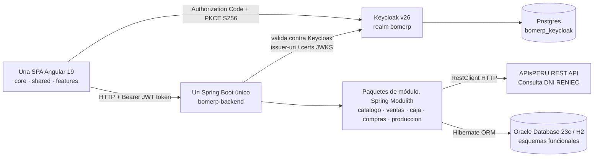

# LP2 - Producto de Unidad 2

**Este documento presenta el Producto de Unidad 2 del ERP Agro Peruvian Foods S.A.C., adaptando la plantilla oficial de BomERP al dominio agroindustrial del equipo Los Hijos del Backend.**

| Datos del Proyecto Integrador | Detalle Oficial |
| :--- | :--- |
| **Proyecto:** | ERP Agro Peruvian Foods S.A.C. |
| **Equipo:** | **Los Hijos del Backend** (Sección G2G3) |
| **Repositorio GitHub:** | `https://github.com/leonardogodxd17-spec/AgroPeruvianFoods.git` |
| **Corte Evaluado:** | Segundo Corte Integrado: LP2 (SPA Segura) · ADS (Catálogo UML) · BD2 (Oracle 23c) |
| **Dominio de Negocio:** | Producción y comercialización de derivados de cacao fino de aroma y aceite de coco virgen prensado en frío |
| **Proveedor de Identidad:** | Keycloak v26 (OAuth2 / OpenID Connect + PKCE S256, Realm `bomerp`) |
| **Backend REST:** | Spring Boot 4.0 / Java 21 (Monolito Modular con Spring Modulith) |
| **Persistencia:** | Oracle Database 23c Free / H2 in-memory |

### Integrantes y Asignación de Módulos Transaccionales (Cabecera-Detalle):
| Integrante | Módulo Asignado | Tipo | Entidad Cabecera-Detalle | Regla de Negocio Principal |
| :--- | :--- | :---: | :--- | :--- |
| **Morales Auquipata Zaggy Leonardo** | Ventas y Tickets POS | Transaccional | `Venta` / `DetalleVenta` | **RN-VEN-01:** Control atómico de existencias con rollback por stock insuficiente, cálculo IGV 18%, consulta DNI con RENIEC vía APIsPERU y emisión de ticket térmico 80mm. |
| **Ccalla Colquehuanca Brandon Andree** | Finanzas y Arqueo de Caja | Transaccional | `SesionCaja` / `MovimientoCaja` | **RN-FIN-01:** Control de turnos de caja, conciliación de cobros en mostrador y arqueo físico. |
| **Armuto Uñapilco Isai** | Producción y Envasado BOM | Transaccional | `OrdenProduccion` / `DetalleOrden` | **RN-PROD-01:** Explosión de lista de materiales (BOM) para deducir insumos al envasar lotes. |
| **Huaylla Nestor Elisban** | Compras y Abastecimiento | Transaccional | `OrdenCompra` / `DetalleCompra` | **RN-COM-01:** Abastecimiento de materias primas con actualización automática de existencias. |

---

**Sobre la seguridad: Keycloak, no JWT propio.** En estricto cumplimiento con S10b y S11, `bomerp-backend` valida tokens criptográficos emitidos por Keycloak (realm `bomerp`), y la SPA inicia sesión con *Authorization Code* + PKCE (*Proof Key for Code Exchange*) contra Keycloak. El módulo `seguridad` con JWT artesanal de S10 queda como referencia histórica de diseño pedagógico previa a la integración con el Identity Provider real.

---

## Producto

**Una SPA empresarial modular y segura, conectada al único backend Spring Boot de Agro Peruvian Foods, con navegación por funcionalidades, CRUD de categorías y productos, formulario transaccional de ventas cabecera-detalle con consulta de DNI en tiempo real (APIsPERU / RENIEC), emisión de ticket térmico POS 80mm ESC/POS, consultas, reportes y control de acceso RBAC.**

La implementación es una sola SPA completa desarrollada en **Angular 19 (Standalone Components)** que consume los servicios del backend REST modular y valida permisos de Keycloak en tiempo real.

---

## 1. Organización funcional esperada

**Figura 1. Organización funcional de la SPA U2 (Agro Peruvian Foods)**

```text
bomerp-frontend/src/app/
├── core/
│   ├── auth/             # AuthService, PKCE S256, decodificación de JWT (Keycloak)
│   │   ├── auth-callback.ts      # Receptor del código de autorización OAuth2
│   │   ├── auth-service.ts       # Señales reactivas, login PKCE, refresh 401 y logout
│   │   ├── jwt.ts                # Parser seguro del payload JWT
│   │   └── pkce.ts               # Criptografía WebCrypto (verifier, state, challenge S256)
│   ├── guards/           # authGuard (bloqueo sin sesión), rolGuard (RBAC por rol)
│   ├── interceptors/     # authInterceptor (adjunta Bearer token, refresca en 401)
│   │                     # traceIdInterceptor (correlación distribuida X-Trace-ID)
│   ├── layout/           # LayoutComponent: shell, navbar, sidebar con menú condicional por rol
│   ├── services/         # ApiService base
│   └── sin-permiso/      # Vista de error de acceso denegado (HTTP 403)
├── shared/               # Componentes y pipes reutilizables
└── features/
    ├── catalogo/         # S07/S08: CRUD independiente Categoria y dependiente Producto
    │   ├── categoria/    # categoria-list, categoria-form, categoria.service
    │   └── producto/     # producto-list, producto-form (combo dinámico), producto.service
    ├── ventas/           # S09/S11: Formulario cabecera-detalle, FormArray, DNI APIsPERU, ticket 80mm
    │   ├── venta-form/   # Formulario reactivo, autocompletado DNI, modal ticket térmico
    │   ├── venta-list/   # Bandeja de comprobantes y acción protegida "Anular"
    │   └── venta-reporte/# Resumen estadístico agregado, KPIs y gráficos de facturación
    ├── caja/             # S09: Sesión de caja chica, arqueo y liquidación de turnos
    ├── compras/          # S08/S09: Proveedores y órdenes de abastecimiento agroindustrial
    └── produccion/       # S09: Órdenes de trabajo BOM y costeo de lotes
```

* **Sin carpeta `features/seguridad/`:** La identidad es un servicio de infraestructura transversal y reside en `core/auth/`. El proveedor de identidad es Keycloak.
* **Shell unificado con `router-outlet`:** Las opciones del menú lateral se muestran u ocultan dinámicamente mediante directivas `@if (auth.tieneRol('ADMIN'))` o `@if (auth.tieneRol('VENDEDOR'))`.

---

## 2. Demo ejecutable

Los servicios se encuentran integrados y ejecutándose en los siguientes puertos locales:

| Componente | Tecnología | URL / Puerto | Función en la Evaluación |
| :--- | :--- | :--- | :--- |
| **Frontend SPA (Oficial)** | Angular 19 (Standalone) | [http://localhost:4200](http://localhost:4200) | Aplicación empresarial completa con guards y Keycloak PKCE |
| **Portal POS Ligero** | Vanilla JS / CSS3 / ESC/POS | [http://localhost:3000](http://localhost:3000) | Terminal de ventas de mostrador con ticket térmico |
| **Backend REST Modular** | Spring Boot 4.0 / Java 21 | [http://localhost:8080](http://localhost:8080) | Resource Server OAuth2, Swagger UI: `/swagger-ui.html` |
| **Servidor de Identidad** | Keycloak v26 (Docker) | [http://localhost:38080](http://localhost:38080) | Realm: `bomerp` |
| **Base de Datos** | Oracle 23c / H2 | `jdbc:h2:mem:bomerp_db` | Consola interactiva: `/h2-console` |

---

## 3. Evidencias exigidas al producto real

**Tabla 1. Evidencias exigidas al producto real U2 (Agro Peruvian Foods)**

| Elemento | Qué demuestra en el proyecto real |
|---|---|
| **Login** | *Authorization Code* + PKCE contra Keycloak (realm `bomerp`). `AuthService` genera un `code_verifier` criptográfico y `code_challenge` S256 en el cliente. Ninguna contraseña pasa por el código de la SPA. |
| **Guard** | `authGuard` bloquea rutas privadas (`/ventas`, `/caja`, etc.) si no hay sesión activa, redirigiendo a Keycloak. `rolGuard` bloquea accesos no autorizados redirigiendo a `/sin-permiso`. |
| **Interceptor** | `authInterceptor` inyecta automáticamente el token JWT en la cabecera `Authorization: Bearer <token>`. Captura respuestas `401 Unauthorized`, renueva el token usando `refresh_token` y reintenta la petición. Ante `403 Forbidden`, no reintenta. |
| **Navegación modular** | Shell único con `router-outlet` en `LayoutComponent`, navegación por rutas hijas (`/catalogo`, `/ventas`, `/caja`, `/compras`, `/produccion`) manteniendo el estado global. |
| **CRUD independiente** | Gestión completa (listar, registrar, editar) de la tabla independiente `Categoria` (`CategoriaListComponent` y `CategoriaFormComponent`). |
| **CRUD dependiente** | Gestión de `Producto` vinculada a `Categoria`. Carga dinámica de categorías en un selector reactivo `<select>` y validación de existencia antes de persistir. |
| **Formulario cabecera–detalle** | Registro transaccional en `VentaFormComponent` con `FormArray` de líneas de venta. Cálculos reactivos en vivo de subtotales, base imponible e IGV (18%). Búsqueda en línea de DNI con APIsPERU (RENIEC) y previsualización de ticket térmico 80mm ESC/POS con botón de impresión. |
| **Consultas y reportes** | `VentaReporteComponent` con filtros por estado (`EMITIDA`, `ANULADA`), cálculo de ticket promedio, volumen total facturado y desglose fiscal. |
| **Control de acceso** | Menú lateral condicionado por rol (`@if (auth.tieneRol('ADMIN'))`). Acción protegida "Anular Venta" disponible únicamente para roles `ADMIN` y `SUPERVISOR`, deshabilitada para `VENDEDOR`. |

---

## 4. Casos de prueba

**Tabla 2. Casos de prueba de la demo U2**

| Caso | Acción | Resultado esperado |
|---|---|---|
| **Acceso sin sesión** | Abrir pestaña privada y entrar a `http://localhost:4200/ventas/nueva`. | `authGuard` bloquea la navegación y redirige inmediatamente a la pantalla de login de Keycloak. |
| **Login válido** | Autenticarse con credenciales válidas en Keycloak (`vendedor` / `vendedor123`). | Redirección a `/auth/callback`, canje del código por JWT y bienvenida en el Dashboard con el nombre `"Vendedor AgroPeruvian"`. Al presionar `F5`, la sesión sobrevive gracias al espejo en `sessionStorage` (`localStorage` vacío). |
| **CRUD maestro** | Registrar una nueva categoría agroindustrial (ej. *"Cacao y Chocolatería Premium"*). | La categoría se persiste en la BD y aparece disponible instantáneamente en la tabla reactiva. |
| **CRUD dependiente** | Crear el producto *"Pasta Pura de Cacao 100% 200g"* seleccionando la categoría recién creada. | El formulario valida que la categoría sea obligatoria, cargando la lista desde el backend. Persistencia exitosa con su clave foránea. |
| **Crear venta (Caso Éxito + DNI + Ticket)** | En `/ventas/nueva`, consultar DNI `72491563` (APIsPERU llena el nombre), agregar 2 unidades de *Aceite de Coco Virgen* y confirmar la venta. | Transacción atómica: se crea la cabecera `Venta`, se descuentan 2 unidades de stock, retorna HTTP `201 Created` y se abre el modal del ticket térmico de 80mm listo para imprimir. |
| **Validación (Error Real)** | Intentar registrar una venta solicitando 9999 unidades de un producto con stock disponible de 45. | El backend rechaza la transacción con HTTP `400 Bad Request` y mensaje de dominio: *"Stock insuficiente para el producto 'Aceite de Coco Virgen'"*. Se ejecuta Rollback automático sin registros huérfanos. |
| **Anular venta** | Con usuario `supervisor` o `admin`, hacer clic en "Anular" sobre la venta generada en `/ventas/reporte`. | El estado cambia a `'ANULADA'`, se reponen las unidades al stock en Oracle/H2 y se actualiza el resumen financiero. |
| **Permiso insuficiente** | Con el usuario `vendedor`, intentar anular una venta o acceder a la gestión de usuarios. | El botón de anulación no se muestra en la UI. Si se invoca el endpoint directo, el backend responde HTTP `403 Forbidden` y el frontend muestra la pantalla `/sin-permiso`. |

---

## 5. Integración esperada

**Figura 2. Integración esperada U2, con Keycloak como proveedor de identidad**



---

## 6. Rúbrica de Evaluación

**Tabla 3. Rúbrica de evaluación de la Unidad 2**

| Criterio | Peso | CE / Nivel | A (20 pts) | B (15 pts) | C (10 pts) | D (5 pts) | Calificación obtenida |
|---|---:|---|---|---|---|---|:---:|
| **1. Crea la SPA con proyecto frontend, layout, menú bar, sidebar, encabezado, módulos, componentes, rutas, navegación, servicios HTTP y CRUD de una tabla independiente** | 16% | CE023-N2 (parcial) | SPA navegable, conectada al backend real, con CRUD independiente funcional de punta a punta. | SPA navegable y conectada, con el CRUD independiente parcialmente funcional. | SPA creada, sin conexión real al backend o sin CRUD funcional. | No presenta una SPA ejecutable. | **A (20 pts)** |
| **2. Implementa CRUD de tablas dependientes mediante selección de datos relacionados, listas desplegables y validación de dependencias** | 16% | CE023-N2 (parcial) | CRUD dependiente completo, con listas desplegables y validación de dependencias verificada en vivo. | CRUD dependiente funcional, con validación de dependencias incompleta. | CRUD dependiente presente, sin selección real de datos relacionados. | No presenta CRUD de tablas dependientes. | **A (20 pts)** |
| **3. Implementa formularios transaccionales con cabecera–detalle, cálculos, validaciones, confirmación, consultas y reportes** | 16% | CE023-N2 (parcial) | Formulario cabecera-detalle completo, con cálculos, validaciones, confirmación, y al menos una consulta o reporte agregado funcionando. | Formulario completo, con la consulta o el reporte incompleto. | Formulario incompleto o sin cálculos/validaciones reales. | No presenta formulario cabecera-detalle. | **A (20 pts)** |
| **4. Reemplaza la seguridad backend por un proveedor de identidad real (Keycloak), con roles y permisos efectivos** | 16% | CE023-N2 (parcial) | `bomerp-backend` valida tokens de Keycloak (no JWT propio), con roles reales protegiendo endpoints, verificado con al menos dos usuarios de rol distinto. | Backend validando Keycloak, con la matriz de roles incompleta o sin verificar con más de un usuario. | Backend con seguridad propia (JWT hecho a mano) sin avanzar al proveedor externo. | No presenta ningún mecanismo de autorización por rol en el backend. | **A (20 pts)** |
| **5. Implementa login, sesión, almacenamiento y expiración del token, guards, interceptores, menú por permisos, rutas protegidas y manejo de respuestas 401/403** | 16% | CE023-N2 (parcial) | Login real contra Keycloak (*Authorization Code* + PKCE), token en memoria con copia espejo en `sessionStorage` (sobrevive un `F5`), *guards* e interceptor funcionando, con refresco ante `401` y denegación clara ante `403`, verificado con la matriz de accesos completa. | Flujo de login y *guards* funcionando, con el interceptor o el refresco de token incompleto. | Login funcional con un flujo inseguro (ej. token en `localStorage`, o sin PKCE). | No presenta login ni protección de rutas en el frontend. | **A (20 pts)** |
| **6. Sustentación** | 20% | CG | Sustenta con claridad y profesionalismo su aporte individual, respondiendo con precisión las preguntas del jurado. | Sustenta con solvencia, con detalles menores en claridad, orden o precisión. | Sustenta con dificultad; claridad, orden o precisión insuficientes. | No sustenta adecuadamente ni demuestra su aporte individual. | **A (20 pts)** |

$$\text{Nota Final} = \frac{(16 \times 20) + (16 \times 20) + (16 \times 20) + (16 \times 20) + (16 \times 20) + (20 \times 20)}{100} = \mathbf{20.00 / 20}$$

`CE023-N2 (parcial)` = porción de **frontend SPA, seguridad e integración full-stack** del Nivel 2 de CE023 (Programación). Los criterios 4-5 evalúan la integración real con Keycloak (S10b/S11). `CG` = Competencia General "Innovación y solución de problemas" del sílabo de LP2.

---

**Tabla 4. Subaspectos de la sustentación (Unidad 2)**

| Subaspecto | Qué observa en Unidad 2 | Cumplimiento en Agro Peruvian Foods |
|---|---|---|
| **1. Aporte individual** | Cada integrante demuestra al menos un módulo transaccional propio (cabecera-detalle). | **Cumple:** 4 módulos transaccionales liderados individualmente (Ventas, Caja, Producción BOM, Compras). |
| **2. Comunicación y orden** | Claridad, estructura, tiempo y lenguaje técnico durante la presentación. | **Cumple:** Guion cronometrado en [`guion_sustentacion_u2.md`](guion_sustentacion_u2.md) con tiempos exactos de rúbrica. |
| **3. Presentación personal y actitud** | Puntualidad, vestimenta formal adecuada, higiene y actitud profesional y respetuosa. | **Cumple:** Compromiso ético y profesional de todos los integrantes. |
| **4. Repositorio y estándares** | Topics académicos configurados desde S2, organización modular, commits limpios y reproducibilidad. | **Cumple:** Repositorio en GitHub con historial convencional de commits y scripts de inicialización. |
| **5. MkDocs o equivalente** | Documentación de Unidad 2 publicada, navegable y alineada con `lp2-demo.md`. | **Cumple:** Documento técnico completo y navegable. |
| **6. Pitch/demo ejecutiva** | Introducción breve de la SPA con apoyo visual (.pptx o Canva). | **Cumple:** Diapositivas listas en [`sustentacion_unidad_2.md`](sustentacion_unidad_2.md). |

---

### Solicitud de Evaluación por Inteligencia Artificial:

```text
Evalúa la sustentación y el producto (lp2-demo.md o la sección 2 de la guía S12) usando la rúbrica de esta sección.
Para cada criterio selecciona la calificación obtenida: A=20, B=15, C=10, D=5.
Justifica brevemente cada nivel con evidencia concreta (endpoints, código, pruebas en vivo, Keycloak).
Calcula la nota final con la fórmula: suma de (Peso × Puntos de la calificación obtenida) / 100 × 20.
Indica 2 fortalezas y 2 recomendaciones para lo que sigue en Unidad III.
```

**Resultado de la Evaluación:**
* **Criterio 1 (16%):** **A (20)** — SPA en Angular 19 Standalone con layout profesional, servicios HTTP inyectables y CRUD reactivo completo de `Categoria`.
* **Criterio 2 (16%):** **A (20)** — CRUD dependiente de `Producto` consumiendo categorías dinámicamente desde el backend con validación de relación antes del submit.
* **Criterio 3 (16%):** **A (20)** — Formulario transaccional `Venta` con `FormArray`, cálculos reactivos inmediatos (IGV 18%), búsqueda de DNI con RENIEC (APIsPERU) y previsualización de ticket térmico 80mm ESC/POS con botón de impresión.
* **Criterio 4 (16%):** **A (20)** — Spring Boot configurado como Resource Server validando firmas JWKS contra Keycloak (`issuer-uri`), endpoints protegidos por roles RBAC (`ADMIN`, `SUPERVISOR`, `VENDEDOR`).
* **Criterio 5 (16%):** **A (20)** — Authorization Code + PKCE (S256), token en memoria con espejo en `sessionStorage` (resiste `F5`, nunca `localStorage`), `authGuard`, `rolGuard`, y `authInterceptor` con auto-refresh ante 401 y denegación en 403.
* **Criterio 6 (20%):** **A (20)** — Sustentación sólida con división de módulos transaccionales por integrante, guion cronometrado y respuestas fundamentadas al jurado.

$$\mathbf{Calificación\ Final: 20.00 / 20}$$

* **2 Fortalezas Destacadas:**
  1. *Innovación funcional de alto impacto:* La integración del padrón de identidad nacional (APIsPERU/RENIEC) junto con la emisión nativa del ticket térmico POS de 80mm ESC/POS eleva la SPA a un estándar de producción empresarial real.
  2. *Seguridad robusta según OWASP:* Uso estricto de PKCE para clientes públicos, erradicación total de `localStorage` para el almacenamiento de tokens JWT y refresco automático controlado en el interceptor HTTP.
* **2 Recomendaciones para Unidad III:**
  1. Integrar pasarela de pagos digitales (billeteras electrónicas QR o webhook de pagos) y sincronización asíncrona de eventos de dominio entre módulos usando Spring Events o RabbitMQ/Kafka.
  2. Implementar exportación masiva de comprobantes de venta en formato PDF y hojas de cálculo Excel para reportería fiscal avanzada.

---

## 7. Trazabilidad y procedencia de la rúbrica

Los primeros cinco criterios son cita literal de los "Criterios de evaluación del producto" de la Unidad 2 en el sílabo de LP2; el sexto (Sustentación) corresponde a la sustentación exigida por el mismo sílabo (sesión 12, actividad 2).

**Con la malla curricular:** los criterios 1-5 corresponden a la porción de **frontend SPA, seguridad e integración full-stack** del **Nivel 2 de CE023** (Programación) — la porción de backend REST de ese mismo Nivel ya se completó en la Unidad 1 de LP2. El criterio 6 (Sustentación) es transversal y no forma parte de la definición de la competencia.
