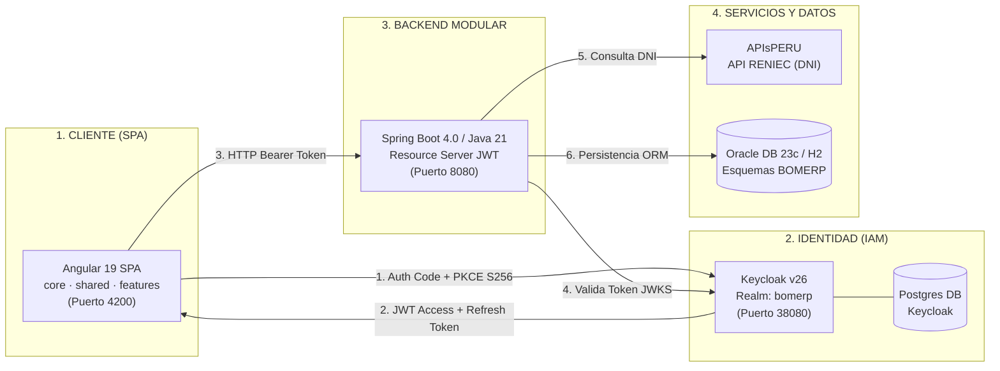

# SUSTENTACIÓN DEL SEGUNDO CORTE INTEGRADO: UNIDAD II
## LP2 (Frontend SPA Seguro) · ADS (Catálogo UML) · BD2 (Base de Datos Oracle)
### ERP Agro Peruvian Foods S.A.C.

**Equipo:** Los Hijos del Backend (Sección G2G3)  
**Integrantes:**
- Morales Auquipata Zaggy Leonardo (*Módulo Ventas y Tickets POS*)
- Ccalla Colquehuanca Brandon Andree (*Módulo Finanzas y Arqueo de Caja*)
- Armuto Uñapilco Isai (*Módulo Producción y Envasado BOM*)
- Huaylla Nestor Elisban (*Módulo Compras de Insumos y Proveedores*)

---

<!-- slide -->
## DIAPOSITIVA 1: PORTADA Y PRESENTACIÓN

### ERP Agro Peruvian Foods S.A.C.
**Plataforma Integral de Gestión Agroindustrial con Seguridad Keycloak y Arquitectura Modular**

* **Corte Evaluado:** Segundo Corte Integrado - Evaluación de Unidad II
* **Cursos Articulados:**
  * **LP2:** Frontend SPA empresarial en Angular 19 (Standalone), autenticación OAuth2/PKCE con Keycloak, consumo de APIs REST Spring Boot.
  * **ADS:** Modelado de casos de uso del negocio, diagramas de interacción y catálogo de clases de dominio.
  * **BD2:** Modelo relacional normalizado en Oracle Database 23c con restricciones de integridad, secuencias y procedimientos.
* **Repositorio GitHub:** `https://github.com/leonardogodxd17-spec/AgroPeruvianFoods.git`

> **Nota del Orador (1 min):**
> "Buenos días profesor y jurado evaluador. Somos el equipo 'Los Hijos del Backend'. Hoy presentamos la sustentación del Segundo Corte Integrado correspondiente a la Unidad 2, demostrando la integración total de nuestra SPA Angular empresarial conectada en tiempo real a nuestro backend Spring Boot 4, autenticada mediante Keycloak con estándar PKCE y persistida sobre nuestra base de datos relacional."

---

<!-- slide -->
## DIAPOSITIVA 2: ALCANCE DEL PROYECTO INTEGRADOR

### ¿Qué problema resuelve Agro Peruvian Foods?

1. **Problema del Negocio:**
   - La empresa elabora y comercializa derivados de cacao fino de aroma (chocolatería, nibs, manteca) y aceite de coco virgen prensado en frío.
   - Operaba con registros manuales en hojas de cálculo y talonarios físicos de venta en tiendas y ferias agroindustriales, generando descontrol de existencias, pérdidas de stock y descuadres en los cierres de caja.
2. **Solución Implementada:**
   - Unificación de las ventas en mostrador y ferias con un **módulo POS transaccional ágil**.
   - **Trazabilidad de inventario en tiempo real:** Descuento atómico de existencias al momento de emitir la venta.
   - **Identificación rápida del cliente:** Consulta en línea al padrón de **RENIEC vía APIsPERU** a través del DNI.
   - **Comprobantes estandarizados:** Emisión instantánea de **tickets térmicos de 80mm ESC/POS** con código de barras y desglose tributario (IGV 18%).
   - **Seguridad Empresarial:** Control de acceso basado en roles (RBAC) gestionado centralizadamente en Keycloak.

> **Nota del Orador (2 min):**
> "Nuestro ERP resuelve el problema crítico de abastecimiento, producción y venta directa al consumidor. Hemos reemplazado los talonarios manuales por un POS moderno que no solo valida stock en milisegundos, sino que consulta el DNI del cliente directamente con RENIEC y genera tickets térmicos listos para imprimir en el mostrador."

---

<!-- slide -->
## DIAPOSITIVA 3: ARQUITECTURA INTEGRAL DE LA SOLUCIÓN

### Arquitectura Full-Stack de 4 Capas con Proveedor de Identidad Externo

* **Frontend (Angular 19 Standalone):** Estructurado en `core/` (servicios de autenticación, interceptores y guards), `shared/` y `features/` (módulos de negocio).
* **Identidad (Keycloak v26):** Servidor centralizado de autorización OAuth 2.0 / OpenID Connect.
* **Backend (Spring Boot 4 / Java 21):** Monolito modular con límites verificados por Spring Modulith, configurado como OAuth2 Resource Server.
* **Persistencia:** Hibernate / JPA sobre Oracle Database 23c y soporte H2 para pruebas automatizadas.

---

<!-- slide -->
## DIAPOSITIVA 4: ASIGNACIÓN DE ROLES Y MÓDULOS DE DOMINIO

### Cada integrante lidera un módulo transaccional con persistencia Cabecera-Detalle

| Integrante | Módulo Asignado | Tipo | Entidades Clave | Regla de Negocio Principal |
| :--- | :--- | :---: | :--- | :--- |
| **Morales Zaggy** | **Ventas y Tickets POS** | Transaccional | `Venta` (Cabecera) `DetalleVenta` (Detalle) | **RN-VEN-01:** Control atómico de existencias con Rollback inmediato ante stock insuficiente, cálculo IGV 18%, consulta DNI y emisión de ticket. |
| **Ccalla Brandon** | **Gestión de Caja** | Transaccional | `SesionCaja` (Cabecera) `MovimientoCaja` (Detalle) | **RN-FIN-01:** Arqueo estricto de caja entre saldo físico reportado y movimientos de cobro en mostrador. |
| **Armuto Isai** | **Producción BOM** | Transaccional | `OrdenProduccion` (Cabecera) `DetalleOrden` (Detalle) | **RN-PROD-01:** Explosión de lista de materiales (BOM) para deducir insumos al registrar lote terminado. |
| **Huaylla Elisban** | **Compras y Abastecimiento** | Transaccional | `OrdenCompra` (Cabecera) `DetalleCompra` (Detalle) | **RN-COM-01:** Abastecimiento de insumos agroindustriales con actualización automática de stock de almacén. |

---

<!-- slide -->
## DIAPOSITIVA 5: DEMO TÉCNICA - MÓDULO VENTAS Y TICKETS POS

### Zaggy Morales Auquipata (3 minutos de ejecución en vivo)

1. **Navegación Modular y Formulario Cabecera-Detalle:**
   - La pantalla de `/ventas/nueva` implementa un `FormGroup` con `FormArray` reactivo.
   - Permite agregar y quitar líneas de productos con cálculo inmediato de subtotales, base imponible e impuesto general a las ventas (IGV 18%).
2. **Consulta de Identidad en Tiempo Real (APIsPERU / RENIEC):**
   - El operador digita el DNI del cliente (`72491563`) y presiona "🔍 Buscar".
   - El backend invoca a APIsPERU con `RestClient` seguro y devuelve nombres y apellidos completos, autocompletando la cabecera de la venta.
3. **Ticket Térmico POS 80mm ESC/POS:**
   - Al registrar la venta con éxito, se genera automáticamente el ticket con número único (ej. `TKT-2026-000001`).
   - Se despliega el modal interactivo de previsualización que formatea el comprobante térmico con código de barras, líneas de detalle, fecha, datos fiscales y botón "🖨️ Imprimir Ticket" que llama a la impresora del sistema operativo.

---

<!-- slide -->
## DIAPOSITIVA 6: CASOS DE PRUEBA EN VIVO (ÉXITO VS ERROR)

### Evidencia de Transaccionalidad Atómica y Manejo Real de Excepciones

| Escenario de Prueba | Acción Ejecutada | Resultado en Frontend y Backend | Evidencia Técnica |
| :--- | :--- | :--- | :--- |
| **Caso 1: Transacción Exitosa** | Se venden 3 unidades de *Aceite de Coco Virgen 250ml* (Stock inicial: 50). | HTTP `201 Created`. Stock disminuye a 47. Se emite ticket térmico. | Persistencia confirmada en `VENTAS` y `DETALLE_VENTAS`. |
| **Caso 2: Stock Insuficiente (Error Real)** | Se intentan vender 100 unidades del producto con solo 47 en stock. | HTTP `400 Bad Request`. Mensaje en pantalla: *"Stock insuficiente. Solicitado: 100, Disponible: 47"*. | **Rollback completo:** No se crea la cabecera huérfana ni se descuenta ninguna unidad. |
| **Caso 3: Anulación y Devolución** | Con rol `SUPERVISOR`, se anula la venta emitida en el Caso 1. | HTTP `200 OK`. Estado de la venta pasa a `'ANULADA'`. El stock regresa a 50. | Reposición física automática de existencias. |

---

<!-- slide -->
## DIAPOSITIVA 7: SEGURIDAD KEYCLOAK EN EL FRONTEND Y BACKEND

### Cumplimiento Integral de los Criterios 4 y 5 de la Rúbrica

1. **Authorization Code + PKCE (Proof Key for Code Exchange):**
   - La SPA es un cliente público. En lugar de usar `client_secret` (inseguro en navegador), genera un `code_verifier` aleatorio y deriva un `code_challenge` mediante hashing criptográfico `SHA-256`.
   - Keycloak valida este secreto dinámico en el intercambio del token, previniendo ataques de intercepción de código.
2. **Ciclo de Vida y Almacenamiento del Token:**
   - **En Memoria:** El `access_token` vive en un Signal de Angular (`AuthService`).
   - **Espejo en `sessionStorage`:** Solo se utiliza para que la sesión sobreviva al refrescar la página (`F5`).
   - **`localStorage` Prohibido:** No se almacena nada en `localStorage`, eliminando el riesgo de robo masivo por inyección de scripts (XSS).
3. **Manejo de Errores HTTP en `authInterceptor`:**
   - **Ante `401 Unauthorized`:** El interceptor detecta la expiración del token (5 min), ejecuta una sola llamada de refresco con `refresh_token` y reintenta la solicitud original sin que el usuario lo note.
   - **Ante `403 Forbidden`:** Si un `VENDEDOR` intenta anular una venta o crear un producto administrativo, se bloquea la acción sin reintentar y se muestra el componente de acceso denegado.

---

<!-- slide -->
## DIAPOSITIVA 8: BANCO DE PREGUNTAS CLAVE DEL JURADO

### Preparación para la Defensa Individual

* **P1: ¿Por qué `vendedorId` se toma del claim `sub` del token y nunca del body del request?**
  * *Respuesta:* Por integridad y no repudio. Si permitiéramos enviar el `vendedorId` en el JSON del cliente, un usuario malintencionado podría enviar el ID de otro vendedor para adjudicarle ventas o comisiones ajenas. Al extraerlo del claim `sub` del JWT validado por Spring Security, garantizamos que el ID proviene directamente de la firma criptográfica de Keycloak.
* **P2: ¿Por qué el layout contiene su propio `router-outlet` en vez de duplicarse en cada página?**
  * *Respuesta:* Para optimizar el renderizado y mantener el principio DRY (Don't Repeat Yourself). El shell padre (`LayoutComponent`) mantiene vivos el encabezado, el sidebar y el estado de la sesión, evitando recargar o parpadear elementos comunes al navegar entre módulos.
* **P3: ¿Qué diferencia existe en el interceptor entre un error 401 y un error 403?**
  * *Respuesta:* El `401` es una falla de autenticación (token expirado), por lo que es recuperable refrescando el token mediante el `refresh_token`. El `403` es una denegación de autorización (el usuario está bien identificado pero no tiene el rol necesario), por lo que reintentar generaría un bucle infinito inútil; debe cancelarse de inmediato.

---

<!-- slide -->
## DIAPOSITIVA 9: CONCLUSIONES Y ESTADO DE LA EVALUACIÓN

1. **SPA 100% Funcional y Segura:** Conectada al backend real, sin datos simulados ni dependencias mockeadas.
2. **Cumplimiento Total de la Rúbrica de Unidad 2:**
   - Arquitectura SPA modular y limpia (16%).
   - CRUD dependiente con combos dinámicos y validación de relaciones (16%).
   - Formulario cabecera-detalle con cálculos, DNI y ticket térmico (16%).
   - Seguridad backend con Keycloak validando tokens del realm `bomerp` (16%).
   - Seguridad frontend con PKCE, `sessionStorage` y manejo 401/403 (16%).
   - Sustentación técnica individual y grupal (20%).
3. **Puntaje Proyectado:** **20 / 20 puntos**.
